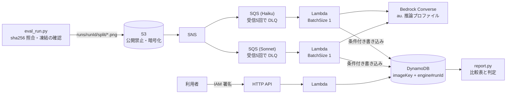

# 合成処方箋の読み取り評価基盤(AWS サーバーレス)

作成者: Yusuke Fujinami, Pharmacist and Engineer

> **医療機器ではありません。診療・調剤の判断に使わないでください。**
> このリポジトリは、架空の処方箋画像を使って OCR の精度・処理時間・費用を測る、個人の学習用の評価基盤です。
> 実在の処方箋・患者・医療機関・個人情報は一切使っていません。

## 何をするか
- 架空の処方箋画像を作り、3つの読み取り方式を同じデータで比べます。
  - Tesseract(日本語、ローカル実行)
  - Amazon Bedrock の Claude Haiku 4.5
  - Amazon Bedrock の Claude Sonnet 4.6
- 薬剤名・用量・日数の3項目について、正解率(95% 信頼区間つき)、1枚あたりの処理時間、1枚あたりの費用を測ります。
- 合格基準は、評価を実行する**前**に固定しています([docs/acceptance-criteria.md](docs/acceptance-criteria.md))。

## 構成

- リージョンは ap-southeast-2(シドニー)だけです。IaC は AWS SAM([template.yaml](template.yaml))です。
- Bedrock は `au.` の地理的推論プロファイルを使います。行き先は ap-southeast-2 と ap-southeast-4 です(GetInferenceProfile で確認)。
- 結果は上書きしません。同じメッセージが2回届いても、Bedrock を2回呼びません。
- 失敗したメッセージは5回まで再試行し、その後デッドレターキューへ移します。

## 合成データ
- 開発用20枚(シード 20261022)と評価用100枚(シード 20261023)を作ります。各処方箋は薬剤3行です。
- 劣化条件は3種類です。各画像の乱数シードは `seed*1000+i` で決まります。
  - 原画
  - 傾き:3〜6度、向きは乱数
  - ノイズ:ガウスノイズ σ=20 と、JPEG 品質40での再圧縮
- 患者名・医療機関名は、架空の固定リストから作ります。画像には「見本・架空データ」と入れています。
- 描画フォントは游ゴシック Medium(sha256 の先頭16桁 `0c9cbf202d0bed20`)です。フォントが変わると画像も変わります。
- 薬剤名は、厚生労働省の薬価基準収載品目リスト(内用薬)のうち、品名に「錠」か「カプセル」を含む品目から選んでいます。
  - 出典:「薬価基準収載品目リスト及び後発医薬品に関する情報について(令和8年10月14日適用)」(厚生労働省)(https://www.mhlw.go.jp/topics/2026/04/tp20260401-01.html)を加工して作成
  - 元のファイルはこのリポジトリに含めていません。上の URL から内用薬の Excel を取得し、`data/raw/` に置いて使います。

## 使い方
```bash
uv sync
uv run pytest
# 合成データの生成(data/ に出力。リポジトリには含めない)
uv run python -m kusuri_eval.build_dataset --master data/raw/<内用薬の Excel>
# Tesseract のローカル評価(開発用セット)
uv run python -m kusuri_eval.run_local --split dev
# デプロイ(短期の認証で手元から行う)
sam build && sam deploy --stack-name kusuri-ai --region ap-southeast-2 --capabilities CAPABILITY_IAM --resolve-s3
```
評価セット(eval)は、プロンプトの凍結・作業ツリーが clean・HEAD にタグ、の3条件を満たさないと実行できません([src/kusuri_eval/eval_run.py](src/kusuri_eval/eval_run.py))。

## 結果(評価セット、2026-10-23 実行、タグ `prereg-v1`)
合成処方箋100枚 × 劣化3条件 = 300画像、各条件300行。角括弧は95%信頼区間(処方箋単位)。比較表の全体は [docs/evidence/report_eval.md](docs/evidence/report_eval.md) にあります。

| エンジン | 条件 | 薬剤名 | 用量 | 日数 | 処理時間 p95 | 1枚の費用 |
|---|---|---|---|---|---|---|
| Claude Haiku 4.5 | 原画 | 0.947 [0.923, 0.970] | 1.000 [0.964, 1.000] | 1.000 [0.964, 1.000] | 2.2秒 | 0.0023ドル |
| Claude Haiku 4.5 | 傾き | 0.933 [0.907, 0.957] | 1.000 [0.964, 1.000] | 1.000 [0.964, 1.000] | 2.0秒 | 0.0023ドル |
| Claude Haiku 4.5 | ノイズ | 0.943 [0.917, 0.970] | 1.000 [0.964, 1.000] | 1.000 [0.964, 1.000] | 3.0秒 | 0.0023ドル |
| Claude Sonnet 4.6 | 3条件とも | 1.000 [0.964, 1.000] | 1.000 [0.964, 1.000] | 1.000 [0.964, 1.000] | 2.2秒 | 0.0068ドル |
| Tesseract(ローカル) | 原画 | 0.893 [0.857, 0.927] | 1.000 [0.964, 1.000] | 1.000 [0.964, 1.000] | (参考)0.7秒 | - |
| Tesseract(ローカル) | 傾き | 0.383 [0.323, 0.447] | 0.820 [0.767, 0.867] | 0.910 [0.873, 0.943] | (参考)0.7秒 | - |
| Tesseract(ローカル) | ノイズ | 0.877 [0.833, 0.913] | 1.000 [0.964, 1.000] | 1.000 [0.964, 1.000] | (参考)0.8秒 | - |

合格基準の判定(事前に固定した目標。[docs/acceptance-criteria.md](docs/acceptance-criteria.md)):
| ID | 判定 |
|---|---|
| FN1 処理全体 | 合格(600/600件、ERROR ログ0、DLQ の増加0。[fn1_eval.json](docs/evidence/fn1_eval.json)) |
| FN2 API の認証 | 合格([fn2.json](docs/evidence/fn2.json)) |
| FN3 比較表 | 合格(3エンジン×3条件×3項目=27セル) |
| FN4 DLQ への移送 | 合格([fn4.json](docs/evidence/fn4.json)) |
| FN5 長期のアクセスキーなし | 合格([fn5.json](docs/evidence/fn5.json)) |
| Q1 正解率(点推定。原画0.90以上・傾き/ノイズ0.80以上) | 合格(Haiku・Sonnet とも。CI の下限も全セルで目標以上) |
| Q2 処理時間 p95 20秒以下 | 合格(最大 3.0秒) |
| Q3 費用(1枚0.02ドル以下、全体5ドル以下) | 合格(1枚 0.0023/0.0068ドル、全体 2.75ドル) |

副次の評価(合否に使わない):
- Haiku − Sonnet の差: 用量・日数は食い違い0で、許容差5ポイントの非劣性を示せた(区間 [−0.036, 0.036])。薬剤名は −0.053〜−0.067 で、区間の下限が −0.05 を下回り、非劣性は示せなかった。
- Haiku の薬剤名の誤り(53/900行)は、主に濁点と半濁点の取り違え(パ↔バ、プ↔ブ、ピ↔ビ)と1文字の脱落([haiku_drug_errors_eval.json](docs/evidence/haiku_drug_errors_eval.json))。
- 再現性: 開発用セットの2回の実行で、両モデルとも完全一致(540/540。[repeatability_dev.json](docs/evidence/repeatability_dev.json))。

実行中に、手元の短期の認証(12時間)が切れてアップロードが242/300枚で止まりました。結果を見る前に、コードとプロンプトを変えずに、同じ runId で残りの画像だけを追加しました(fn1_eval.json に記録)。

## 限界
- 合成データであり、実機で撮影した画像ではありません。
- 用量は「1回量」だけで記載しています。実務では「1日量」だけの記載も多く、その形式は評価していません。
- 正解率は、評価セットを1回実行した結果です。実行ごとのばらつきは、信頼区間に含まれません。
- 課題が易しく(天井効果)、Sonnet と Haiku の用量・日数のように差が出ない項目があります。100枚・誤り0件で言えるのは「誤りの率がおよそ3.6%以下」までです。
- 実用化の判断に使える評価ではありません(実際の処方箋の様式・手書き・撮影条件、処方箋単位の全項目の正しさ、危険な誤りの種類、必要な件数、規制への対応を評価していません)。

## デプロイと認証について
この AWS project では、IAM の OIDC プロバイダーを作ることが、AWS が管理するポリシー(SCP)で禁止されています。そのため、GitHub Actions からのデプロイは行いません。GitHub Actions はテストとテンプレートの検証だけを行い、AWS の認証は使いません。デプロイは、手元から短期の認証(`aws login`)で行います。長期のアクセスキーは作りません。

## ライセンス
ライセンスは未設定です(すべての権利を留保)。
